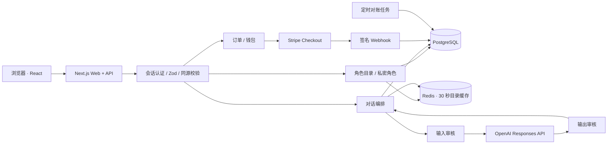
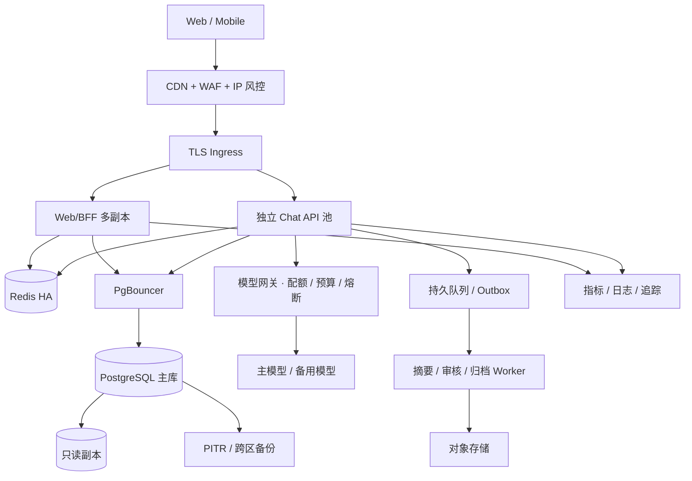

# 02 · 架构设计图与十万日活容量

## 当前实现架构

这是模块化单体，方便本地运行和保证钱包事务。图中的模块并非已独立部署的微服务。所有 Pod 共享 PostgreSQL 和 Redis，无需会话粘滞。
## 目标扩容架构

独立 Chat API、模型网关、Outbox、只读副本路由、遥测与对象存储属于扩容设计，本次代码尚未全部实现。Kubernetes 模板是起点，不是容量证明。
## 可复算容量假设
- DAU = 100,000；每人每天 20 次用户发言；每天 2,000,000 次模型调用。
- 平均请求速率 = 2,000,000 / 86,400 = 23.15 次/秒。
- 峰值系数取 10，设计峰值约 232 次/秒；按 2 倍余量预留 464 次/秒。系数须用真实业务曲线修正。
- 平均端到端生成 8 秒：峰值在途请求 232 × 8 = 1,856；按 2 倍余量预留约 3,712 条连接。在线用户数不能直接等同于模型并发。
- 按每次 2,000 输入 token、300 输出 token：每日 40 亿输入、6 亿输出 token；峰值输入 2,784 万 TPM、输出 417.6 万 TPM、13,920 RPM。模型账户配额往往先于应用算力成为瓶颈。
- 每天写入约 400 万条 ChatMessage。按每条含索引 2 KB 估计 8 GB/日、240 GB/月，再预留副本、备份和 WAL；这是假设，不是实际测量。
## 资源起点与扩容触发
应用从 3 副本、每副本 0.5 CPU / 512 MiB 请求起步；CPU HPA 3–30 副本只作为模板。大规模上线应增加在途生成数、事件循环延迟和排队时间指标，进行实测后确定每 Pod 上限，低 CPU 的长连接不能只靠 CPU HPA。
PostgreSQL 使用跨可用区托管实例；从 8 vCPU / 32 GB 的压测候选开始，使用 PgBouncer，连接预算随实例调整。Redis 高可用，限流/锁与可淘汰缓存建议分实例。消息表按月分区与冷热归档应在数据增长前通过迁移实现；当前 Prisma schema 尚未分区。
## 一致性与故障
- 余额条件更新、请求预扣记录和扣费流水在同一事务内提交。
- 请求 UUID 全局唯一，重复完成请求返回既有回复；相同 UUID 不允许改变用户、角色或内容。
- 单用户 Redis 锁 180 秒；模型超时 60 秒，输入输出审核各 15 秒。断开浏览器连接不等于取消已接受业务，请刷新查看最终状态。
- 生成完成时消息对与请求完成状态事务提交；失败通过状态条件更新退款。进程崩溃后 5 分钟以上 PENDING 由每 2 分钟 CronJob 恢复。
- 支付签名和金额/币种检查后，PENDING 到 PAID 仅一次，订单、余额、流水同事务。
- 目标 RPO ≤ 5 分钟、RTO ≤ 30 分钟，必须恢复演练达标。数据库异常优先停止收费生成，不采用本地余额降级。
## 成本模型
每日模型成本 = 输入 MTok × 输入单价 + 输出 MTok × 输出单价；另计重试、上下文增长、审核、云数据库、流量、支付手续费与税费。以官网当次展示的 GPT-6 Luna 输入 $0.1/MTok、输出 $0.5/MTok 为示例，以上负载约 $700/日；这只是模型推算，不是账单或承诺报价。正式预算必须以账户合同、区域与最新价目为准。
模型依据：[OpenAI 官方模型目录](https://developers.openai.com/api/docs/models)。
