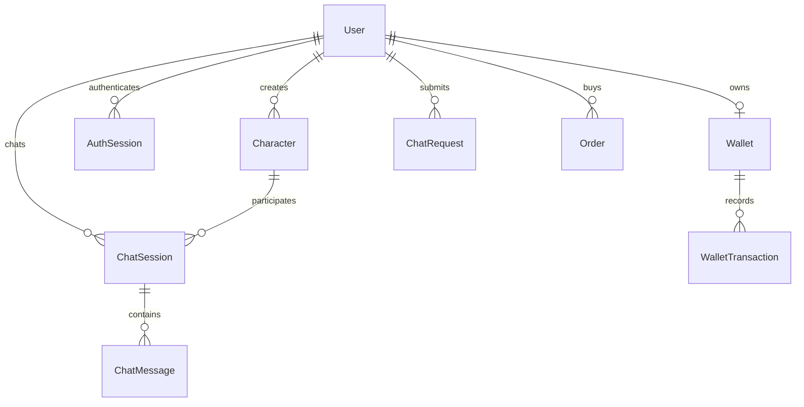
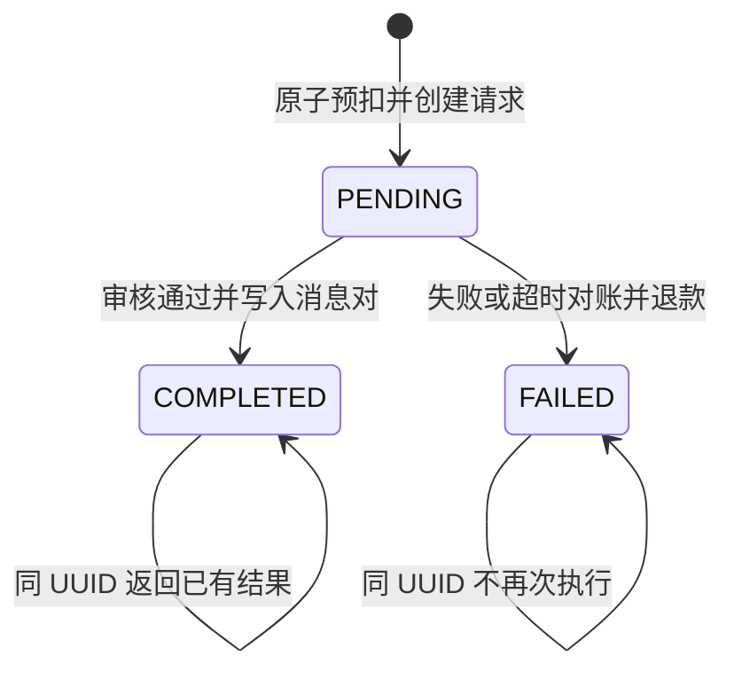

# 04 · 数据库设计与资金一致性

## 实体关系

## 表与约束
User：cuid 主键，email 唯一，passwordHash，nickname，ACTIVE/FROZEN/DELETED 状态和时间。邮箱统一转小写。冻结账户认证失败。
AuthSession：tokenHash 主键，userId 外键，expiresAt 索引。cookie 只存随机原始 token；数据库不存可直接复用的 token。
Wallet：userId 唯一，balance 整数星币，CHECK balance ≥ 0，updatedAt。
WalletTransaction：walletId 外键，amount 带正负号，reason，refType/refId 联合唯一，walletId/createdAt 索引。当前系统是余额+流水账本，不是完整财务复式记账系统。
Character：ownerId 可空（官方种子），name/title/avatarUrl/greeting/systemPrompt/tags，单价正整数，status 和 popularity 索引；DRAFT 为私密。
ChatSession：userId+characterId 唯一，一用户一角色一会话，userId/updatedAt 索引。多会话分支需要后续产品与表结构扩展。
ChatMessage：sessionId、role、content、costCoins、model、时间，sessionId/createdAt 索引；promptTokens/outputTokens/latencyMs 为预留字段，当前未采集。
ChatRequest：客户端 UUID 主键、userId 外键、characterId、content、coins、PENDING/COMPLETED/FAILED、reply、时间。status/createdAt 支持对账扫描。characterId 当前为快照字符串，访问权限在创建前检查。
Order：客户端 UUID 订单主键，userId、provider、providerRef 唯一、amountCents、coins、状态、createdAt/paidAt。金额与星币 CHECK > 0。
## 金额与账本不变量
人民币金额以分存储，星币以整数存储，套餐价格由服务端 plans 常量决定。无浮点金额运算参与到账。
对每个钱包要求 balance = SUM(WalletTransaction.amount)，新用户 30 星币也写入流水。余额快照更改必须与流水同事务；禁止运营直接改表调余额。
支付回调重复 8 次，只能增加一次余额；退款同样按请求状态原子更新去重。账本独立 refType 区分 CHAT 预扣和 REFUND 退回。
## 请求状态机

## 索引、保留与扩展
当前表未分区。按 400 万消息/日评估，目标按月分区、保留 90 天热数据、旧消息加密归档到对象存储；保留期限应由产品与隐私要求最终确认。必须同步设计查询时间边界和删除/导出流程，不能直接删除分区造成账本失联。
角色目录支持最多 60 项，消息读取最近 100 项，会话列表 50 项、流水 50 项、订单 20 项。扩大数据集前补稳定游标分页；不要无限 offset 扫描。
PII、密码哈希与会话 token 不进入日志。生产数据库启用静态加密和 TLS，应用账号最小权限；迁移使用单独权限账号。定期清理过期 AuthSession。
## 迁移文件
prisma/schema.prisma 是类型源；prisma/migrations/20261005082031_initial/migration.sql 创建基础表；20261005082500_constraints 增加余额、单价、状态约束。
生产只用 prisma migrate deploy。使用 expand/contract 兼容迁移；应用回滚不自动回滚数据迁移，数据恢复必须单独评估。
