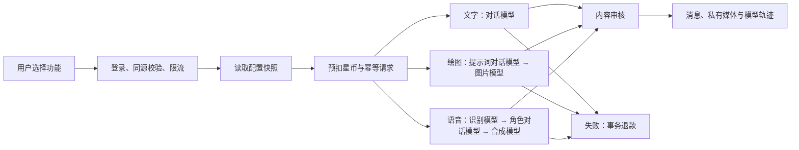

# 多供应商模型与功能编排

后续配置入口与聊天运行模式已更新，以 [常用供应商与密钥配置](provider-presets.md) 为准：快速配置可以一次启用供应商、默认聊天模型及文本审核方式。文字聊天模式独立于演示充值，已启用真实聊天路由不会再被 APP_MODE=demo 覆盖。原有图片、语音和专用图片审核的限制保持不变。

## 管理入口

后台 `/admin/models` 提供供应商、模型目录、功能路由和调用记录四个视图。配置修改先留在浏览器草稿中，填写发布原因后整体提交。发布采用版本检查与事务锁，过期页面返回409，不覆盖其他管理员的修改。每次发布写入审计日志。

供应商预置为 OpenAI、DeepSeek、阿里云百炼、Anthropic 和 Google Gemini。每个供应商可配置独立名称、API Key和启停状态。接口地址固定到官方端点，不允许填写任意代理地址，避免SSRF和密钥发送到未知主机。百炼目前使用北京地域兼容接口。

## 支持能力

- OpenAI：聊天、图片生成、语音识别、语音合成。
- DeepSeek、百炼：OpenAI兼容的文本聊天接口。
- Anthropic：原生Messages文本聊天接口。
- Gemini：原生generateContent聊天及返回inlineData的图片生成接口。

模型ID由管理员按照自己的供应商账户权限填写。不是所有同名供应商模型都具备所有能力。服务端校验供应商适配器能力与路由能力，图片或语音专用原生接口尚未适配的供应商不能被配置为这些能力。聊天模型提供小额付费连通测试，必须先保存、启用并确认费用。

## 自动组合



用户无需选择具体供应商。聊天界面的对话、绘图、语音模式决定执行图；后台路由决定每步的主模型和可选备用模型。同一次请求使用同一配置快照。文字按角色单价计费，绘图和语音按路由设置的整次星币价格计费，不按每步重复扣款。

备用模型仅用于网络异常、超时、429或5xx。鉴权、模型配置、内容拒绝等非临时失败不切换，以免绕过安全限制。每步最多两个候选模型、每次调用20秒超时；流程有固定输出和文件大小上限，不允许模型自行执行工具、访问网址或递归增加调用。

## 安全与运行条件

- API Key以AES-256-GCM加密，供应商ID作为关联数据，数据库不保存明文。GET只返回是否已配置，不返回密钥或密文。密钥不能进入日志、CSV或前端环境变量。
- 所有服务副本必须使用相同的64位十六进制 `AI_CONFIG_ENCRYPTION_KEY`。本地已生成主密钥。生产通过Secret管理，备份时同时保存主密钥和数据库。不能直接更换主密钥，需另行安排解密再加密迁移。
- 沿用OpenAI `omni-moderation-latest`审核输入、文本输出及生成图片。可使用环境变量 `OPENAI_API_KEY` 或后台已启用的OpenAI供应商密钥。即使聊天选择其他供应商，也需要该审核凭证；缺少时失败关闭，不降级为无审核模式。
- `APP_MODE=demo` 不调用付费模型。新增绘图、语音功能显示未启用。正式调用需要切换 `APP_MODE=production`、填写有效凭证并发布完整路由；预置配置不会自动产生供应商费用。
- 请求UUID与内容摘要绑定，已完成请求重放不重复扣款；处理中拒绝重复执行。失败退款和超时对账沿用原有资金事务机制。
- 每位用户限制同时一条文字或多模态请求；多模态请求默认每分钟五次，音频最大5MB，浏览器录音最多60秒。上传文件不保留原始录音，只保存识别文本及合成回复。
- 媒体使用随机UUID，由服务端审核后写入，不允许SVG和外部媒体URL下载。`/api/media/:id`逐次验证所属用户及请求完成状态，管理员没有私有媒体的绕过权限。

## 部署

```bash
npm run db:deploy
npm run prisma:generate
npm run build
npm run start -- --port 3100
```

新增迁移为 `20261008010000_model_routing`，包含AIConfiguration、MediaAsset、请求功能及结果字段、消息附件字段。

本地媒体目录默认 `.data/media`，Docker Compose使用持久卷。Kubernetes先创建 `deploy/media-storage.yaml` 中的RWX共享卷，再部署应用。必须将存储类占位符换成真实可支持ReadWriteMany的网络存储类；三个及以上副本不能使用彼此隔离的本地目录。反向代理已增加6MB上传上限和180秒等待时间。生产需设置媒体备份、保留周期、容量告警和共享存储性能监控。

现实现采用共享文件存储，不是对象存储/CDN方案；10万日活上线仍需要按真实图片与语音占比验证存储吞吐、供应商配额、并发控制和成本预算。未执行真实供应商费用测试、外部发布或10万日活负载验收。

## 验证

```bash
npm test
npm run typecheck
npm run test:integration
npm run test:admin
```

模型流程验收使用隔离端口3101和预加载模拟供应商，禁止联系真实供应商，既不需要真实API Key，也不会产生费用：

```bash
MODEL_MOCK_TEST=1 APP_MODE=production APP_URL=http://localhost:3101 \
OPENAI_API_KEY=test-model-moderation NODE_OPTIONS='--import ./tests/mock-models.mjs' \
npm run dev -- --port 3101
# 在另一终端运行
APP_URL=http://localhost:3101 npm run test:models
```

覆盖密钥加密与脱敏、原生/兼容协议、能力约束、版本冲突、绘图与三步语音、媒体权限、重放幂等、临时故障备用切换、全部失败退款、输入审核阻断及文字路由自动选择。模拟测试证明编排与资金/权限行为，不证明供应商账户授权、生成质量或声音质量；这些需配置真实账户后按灰度验收执行。

## 接口参考

- [OpenAI图片API](https://platform.openai.com/docs/api-reference/images/create)
- [OpenAI语音识别](https://platform.openai.com/docs/api-reference/audio/createTranscription)
- [OpenAI语音合成](https://platform.openai.com/docs/api-reference/audio/createSpeech)
- [DeepSeek兼容接口](https://api-docs.deepseek.com/)
- [阿里云百炼Base URL](https://help.aliyun.com/zh/model-studio/base-url)
- [Gemini生成接口](https://ai.google.dev/api/generate-content)
